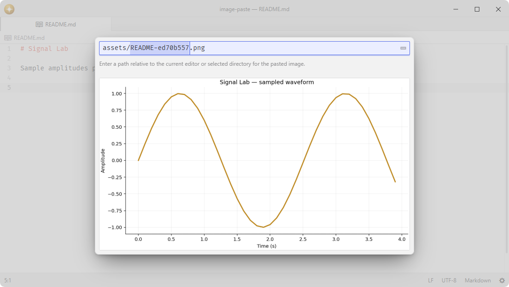

# image-paste

Paste clipboard images into projects as image files.

## Features

- **Native clipboard support**: reads standard image data from clipboard events with an Electron fallback.
- **Project-relative paths**: suggests a destination based on the active editor, tree selection, or terminal launch directory.
- **Automatic naming**: suggests stable names based on the document and image content.
- **Editor integration**: inserts a document-relative path after a successful save when the destination can be expressed relative to the document.
- **Tree-view integration**: suggests the active folder or the parent of the active file.
- **Terminal integration**: writes an absolute, shell-safe path onto a terminal's input line.



## Installation

To install `image-paste` search for it in the Install pane of the Lumine settings, or run the command `lumine --install lumine-code/image-paste`.

## Commands

Commands available in `lumine-text-editor:not([mini]):not([readonly]):not(.tree-view lumine-text-editor)` and `.tree-view`:

- `image-paste:paste` opens the save dialog for the focused editor or Tree View selection.

## Usage

Copy an image, invoke the normal paste command or `image-paste:paste`, review the suggested path, and confirm the save. With one project folder, enter a path relative to its root. With several, start a relative path with a unique project folder name, such as `notes/docs/figure.png`. Absolute paths work in either case and are suggested for destinations outside the project or in roots that share a name.

The default suggestion for a text editor puts the image in `assets` beside the document. The dialog initially selects the filename without its extension. Press `F2` to switch between that selection and the whole filename. PNG, JPG, and JPEG output names are supported. Other extensions are converted to PNG.

Pasting into a terminal suggests a destination in the directory where the terminal was launched. After saving, it writes the absolute path onto the input line so it still works if the shell has moved to a different directory. Paths containing whitespace are quoted. The line stays ready for editing or submission.

## Customization

Customize the modal with CSS and package custom properties:

```css
.image-paste.save-dialog {
  max-width: 52rem;
  --image-paste-preview-max-height: 24rem;
}
```

## Services

- `tree-view.selection`: consumed to locate the selected directory for explicit image paste commands.

## Contributing

Got ideas to make this package better, found a bug, or want to help add new features? Just drop your thoughts on GitHub. Any feedback is welcome!
